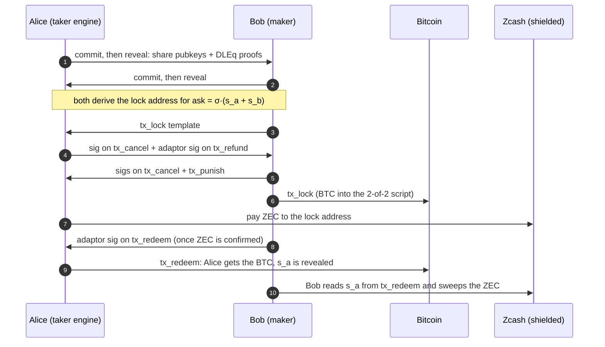
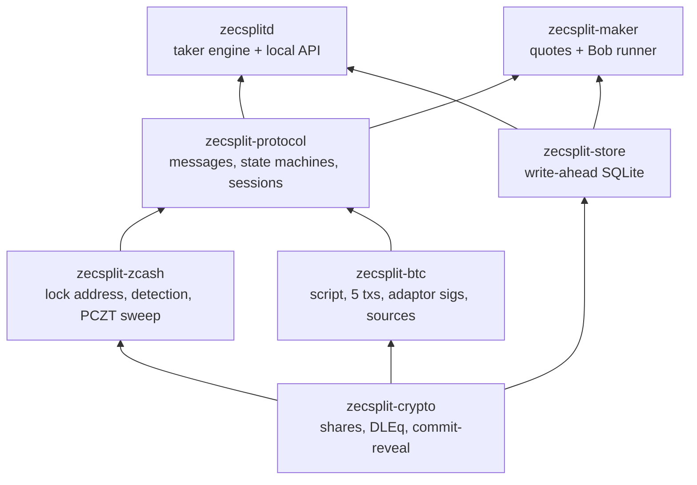

<p align="center">
  
</p>

<h1 align="center">ZecSplit</h1>

> **Swap shielded ZEC for native BTC. Nobody in the middle can freeze it or take it.**
>
> A trustless atomic swap between the Zcash Ironwood pool and Bitcoin: no bridge, no custodian, no wrapped coin, no transparent Zcash address.
> Only Bitcoin's timelocks and Zcash's consensus decide who ends up with what.

[](https://github.com/trudransh/ZecSplit/actions/workflows/ci.yml)


[The app](https://zecsplit.vercel.app) · [the video](https://www.youtube.com/watch?v=lAWoqCJCH1A) · [the docs](docs/README.md) · [the evidence](evidence/testnet) · [run it yourself](#run-it-yourself)

> [!WARNING]
> **Pre-alpha. Regtest and testnet only. Unaudited.** Do not use with real funds.

## For judges (5 minutes)

1. **Watch** [the video](https://www.youtube.com/watch?v=lAWoqCJCH1A): a swap in the web app, then the proof on public explorers.
2. **Check a timelock on a public chain, nothing to install** (`curl` and `jq`). Swap `d9c9794f` was abandoned after the maker locked BTC; its cancel could only be mined 36 blocks after the lock, and was:

   ```bash
   M=https://mempool.space/signet/api/tx; L=d1dcc58c246451446b20f6a305f4e2697cbd0ad605d9e8a3ddfceb59fab3e5a8
   curl -s $M/efed99572f863eb1782088da7a8e1b2ebe17b0f3265fd970325a04f8dd28659a | jq -r --arg l $L \
     --argjson h "$(curl -s $M/$L/status | jq .block_height)" \
     '"spends the lock: \(.vin[0].txid == $l), nSequence: \(.vin[0].sequence), mined \(.status.block_height - $h) blocks after it"'
   ```

3. **Check the cryptography against the chain** (Rust, no Docker): `just verify` takes the public record of each of our four testnet swaps, checks both cross-group DLEq proofs and all six proofs of knowledge, fetches `tx_redeem` from mempool.space and recovers the taker's key share from the signature in it: the step that lets the maker sweep the ZEC. Change one byte of a record and it fails.
4. **Run a full swap in the web app, no coins needed** (Docker and Rust): `just judge` starts a private regtest world on your machine and opens [the app](https://zecsplit.vercel.app) against it. About 2 minutes per swap.
5. **Real and simulated, in one line:** the four swaps and the refund ran on Zcash testnet and Bitcoin signet with real keys, proofs and signatures; the app's *Try the demo* button is a simulation with no chain behind it ([the full list](#what-is-real-and-what-is-simulated)).
6. **Read on:** [the live run on the explorers](#the-live-run-on-the-explorers), [the raw evidence](evidence/testnet), [the protocol](docs/protocol.md), [the threat model](docs/security/threat-model.md), [the limits](#limits).

The name means a *split key*: the ZEC sits under a spend key split between the two parties.

## What it does

Shielded Zcash has no scripting language, so it can't hold a hash-locked contract. ZecSplit ports the Bitcoin–Monero protocol of Gugger (2020), the one COMIT and eigenwallet have run since 2021:

- The ZEC is paid to a fresh shielded address whose spend key is `ask = σ·(s_a + s_b)`. Alice holds `s_a`, Bob holds `s_b`; neither can spend alone.
- Bitcoin holds the conditions: a 2-of-2 output, and transactions both sides sign before any coin moves, with relative timelocks for cancel (`t1`) and punish (`t2`).
- Each Bitcoin spend reveals **exactly one share** to the other party through an ECDSA adaptor signature. Whoever learns the missing share sweeps the ZEC.
- A cross-group discrete-log equality proof ties each share on Pallas (Zcash) to its twin on secp256k1 (Bitcoin), so nobody can cheat with mismatched keys.

On Zcash, a swap is two ordinary shielded transactions, unlinked to the Bitcoin side. The keys live in an engine on your own computer; the web app is only a screen.

### How a swap works

Alice has ZEC and wants BTC (the taker). Bob has BTC and wants ZEC (the maker).



If something goes wrong, the timelocks decide:

| Situation | What happens | Who gets what |
|---|---|---|
| Bob never locks BTC | Alice never pays ZEC. Nothing to undo. | Both keep their coins |
| Alice never pays ZEC | After `t1`, `tx_cancel`, then Bob's `tx_refund` | Bob gets his BTC back |
| Bob goes silent after Alice pays | After `t1`, Alice cancels. Bob's `tx_refund` reveals `s_b` | Bob gets BTC back, Alice sweeps her ZEC back |
| Bob never refunds | After `t2`, Alice's `tx_punish` | Alice takes the BTC; the ZEC stays locked |


## What works today

| Flow | Result |
|---|---|
| Happy path | 4 swaps on Zcash testnet + Bitcoin signet, the 4th through the hosted web app |
| Maker abandons after locking | Cancel mined at exactly `t1` on signet, then the maker's refund |
| Every failure path | Maker never locks, taker never pays, maker silent after payment (taker sweeps ZEC back), maker never refunds (taker punishes), overpayment: on regtest through the real engine and maker |
| Crash and resume | Both sides rebuilt from SQLite before every block, at every state |
| Public verification | `zecsplit-verify` re-derives each testnet swap's atomicity from public data |
| Web app | Connect, quote, recovery file, ZIP 321 QR, live progress, receipt; hosted, talking only to `127.0.0.1` |
| Judge kit | `just judge`: devnet, maker and engine on one machine, driven from the hosted app |

## The live run on the explorers

The maker ran on a cloud VM and checked the ZEC lock on its own Zebra node; the taker's engine ran on a laptop.

| Swap | Maker locks BTC (signet) | Taker pays ZEC (testnet) | Taker claims BTC (signet) | Maker sweeps ZEC (testnet) |
|---|---|---|---|---|
| 1 | [`dbc65938…`](https://mempool.space/signet/tx/dbc6593847db04dec256aca4dae00c8b5df6a478731d981291be2c7b7937cda1) | [`62cfea06…`](https://testnet.zcashexplorer.app/transactions/62cfea0652d9ec5675db266bcc28f6bac7e63b0ba0f2443b5a1cf03e1e88805c) | [`8968f8f0…`](https://mempool.space/signet/tx/8968f8f08afe3f0bce599b47115f28f42bd0d67ea04f1a92df9137fa525be35d) | [`22451c4e…`](https://testnet.zcashexplorer.app/transactions/22451c4e6e6c8e720ddfec7cc45756b76ed3e9cc95628773c08c3685e94a25e7) |
| 2 | [`224e049f…`](https://mempool.space/signet/tx/224e049f3ba6f7945304e0ed684f8009ccfb1159bf557bb4c7d51873e17af774) | [`2139bd7a…`](https://testnet.zcashexplorer.app/transactions/2139bd7a3a0cb4b24438bca3cf3464d6e83d5eea384fbcd1901114e5f0a8824d) | [`f1569274…`](https://mempool.space/signet/tx/f15692748402e1730c8d36fee1ff3d212057027ac40668381a249f640d2205bd) | [`9125fcb0…`](https://testnet.zcashexplorer.app/transactions/9125fcb06fa15dce4301c17bbbe3b451de0a1769c710d8b1cbaec1f8bfe6a8fc) |
| 3 | [`27024c5d…`](https://mempool.space/signet/tx/27024c5da837cb9ed1dc4eeda2c2f128d4692418e9dea07000f0bdee7af48f9a) | [`abdb747f…`](https://testnet.zcashexplorer.app/transactions/abdb747f0f471fd6a9844940c2db95ef43e68c5362a8a99912ed19f57e189aa6) | [`dce3fce1…`](https://mempool.space/signet/tx/dce3fce1aa550cab3b3e7e2b190b1a2b4388f51104471d375252fcfaf29b3d35) | [`85af11f5…`](https://testnet.zcashexplorer.app/transactions/85af11f506ee0fbf558b2f9d612f7bef1d05d68d027186bb8c02208d528a2c30) |
| 4 (web UI) | [`7e91162a…`](https://mempool.space/signet/tx/7e91162ab130a637f22cde5be9c86517f9b475d6be5473fa6892415ced5cfc8a) | [`e3585ecb…`](https://testnet.zcashexplorer.app/transactions/e3585ecb7f233cb4f3ef4a1d89fec486768330e66beaddb4d4427a91a437ca46) | [`e54c639f…`](https://mempool.space/signet/tx/e54c639f355efa075fa80319b465789fb2528c7ef383393822356a534f052f2b) | [`2e264fe9…`](https://testnet.zcashexplorer.app/transactions/2e264fe99a1864169301fc8dad0e950ac8550cc2f5630f01b8d08f09154168b7) |

The refund, with nobody cooperating:

| Maker locks BTC | Cancel, valid only from `t1` = 36 blocks after the lock | Maker's refund |
|---|---|---|
| [`d1dcc58c…`](https://mempool.space/signet/tx/d1dcc58c246451446b20f6a305f4e2697cbd0ad605d9e8a3ddfceb59fab3e5a8) at block 328056 | [`efed9957…`](https://mempool.space/signet/tx/efed99572f863eb1782088da7a8e1b2ebe17b0f3265fd970325a04f8dd28659a) at block 328092 | [`1503cf53…`](https://mempool.space/signet/tx/1503cf53e194fd1affae7f481f3f7b08057315daae8b84652dc96c2ae5a5ceab) at block 328093 |

Raw JSON of all 19 transactions, the Ironwood-only check and the swap records: [`evidence/testnet`](evidence/testnet).

## What is real and what is simulated

**Real**, on Zcash testnet (NU7, Ironwood) and Bitcoin signet:

- The shared-key lock address and the sweep with both shares, through PCZT.
- The cross-group DLEq proofs, commit-reveal and the six proofs of knowledge.
- The Bitcoin 2-of-2 output, the five transactions, ECDSA adaptor signatures and the relative timelocks.
- The engine (`zecsplitd`) and the maker (`zecsplit-maker`) as separate processes over HTTP, each with a write-ahead SQLite store.
- The web app, hosted on Vercel and driving a local engine.

**Not real, or not yet:**

- *Try the demo* in the app: a simulation, labelled as one, with no transactions.
- The regtest suite and the judge kit: real nodes, but private chains.
- Independence of the taker's Bitcoin sources on testnet: one was the maker's own bitcoind (the other mempool.space). Both must agree, so a lying node can only stall a swap.
- Liquidity: one maker, ours.
- Mainnet: none.

## How it has been attacked

- **Model check.** Both state machines are driven through 20,000 random runs each, with reorgs, disagreeing Bitcoin sources, block jumps and hostile peer messages. After every step it checks the rules that keep funds safe: no payment request before a confirmed lock, no redeem inside the safety margin, no cancel against your own redeem, no sweep without the other side's secret, no abort after paying or locking. It found a real bug (a reorg could abort a taker who had already paid), now fixed. A review found a second one: a lagging Bitcoin source could push a redeem into the safety margin. Fixed: the taker now uses the highest tip any source reports and one lock height every source agrees on (ADV-10).
- **Fuzzing.** Mutated setup signatures, adaptor signatures, lock templates and reveals are all rejected, before and after the real one, and never leave a session unusable. The wire and recovery-file decoders take 60,000 random inputs without a panic.
- **Adversarial tests** for a fake BTC lock, a maker checking ZEC on someone else's node, wrong ZEC amounts, a signature arriving inside the safety margin, a blocked refund (the taker punishes) and quote flooding.
- **Privacy tests on real chains.** Every Zcash transaction has zero transparent, Sapling and Orchard parts, only Ironwood actions (the maker's sweep always has exactly 2); no secret appears in any file the engine or maker writes; nothing asks a light server for a transaction by id.

## Repository layout



- **The browser holds no keys.** The local engine runs the swap and owns every secret.
- **Write-ahead.** Every state change is committed to SQLite before the message or broadcast it allows.
- **Two Bitcoin sources.** The taker acts on a Bitcoin fact only when both agree.

| Path | What |
|---|---|
| `crates/` | The Rust workspace above |
| `apps/web` | The web app (Next.js static export) |
| `devnet/` | Zebra regtest + bitcoind + wallet, and the judge kit |
| `evidence/testnet` | Raw testnet transactions and swap records |
| `docs/` | The documentation |
| `ops/testnet` | The maker VM's stack and runbook |
| `vendor/` | Serai `dleq` and `pasta_curves`, vendored ([CREDITS](CREDITS.md)) |

## Run it yourself

Needs Rust 1.93, Docker and [`just`](https://github.com/casey/just).

```bash
just judge                                     # devnet + maker + your engine; prints the app link and a BTC address
just judge-pay '<zcash: link under the QR>'    # pays the QR from the devnet wallet, in a second terminal
just verify                                    # checks the four testnet swap records against signet
just devnet-up && just demo                    # scripted: 3 swaps, privacy checks, a refund; prints every txid
```

The first build of the Zcash crates takes several minutes. Development: `just setup` (git hooks), `just check` (what CI runs), `just devnet-test` (every scenario on regtest).

## Limits

- Pre-alpha, unaudited, regtest and testnet only.
- One maker. Its API is plain HTTP; our testnet runs went through an SSH tunnel. Put HTTPS or Tor in front of it.
- On testnet the taker's Zcash light server was the maker's. It is used only on the refund path, where the maker would see the taker's sweep.
- A completed swap proves neither party could take both coins. It doesn't prove the price was fair, and the Bitcoin side is as public as any Bitcoin payment.
- A testnet swap takes 45–90 minutes, mostly Bitcoin confirmations.

## Docs

[docs/](docs/README.md) in this repo, mirrored at [zecsplit.gitbook.io/zecsplit-docs](https://zecsplit.gitbook.io/zecsplit-docs/).

| Start here | |
|---|---|
| [Core concepts](docs/core-concepts.md) | The idea in ten minutes |
| [Protocol](docs/protocol.md) | The spec, rule by rule |
| [Threat model](docs/security/threat-model.md) | 25 threats, their mitigations and tests |
| [Privacy](docs/security/privacy.md) | What each observer learns |
| [Paper](docs/resources/paper.md) | The protocol in paper form |

## License

Dual-licensed under [MIT](LICENSE-MIT) or [Apache-2.0](LICENSE-APACHE), at your option. Third-party work and notices: [CREDITS.md](CREDITS.md).
