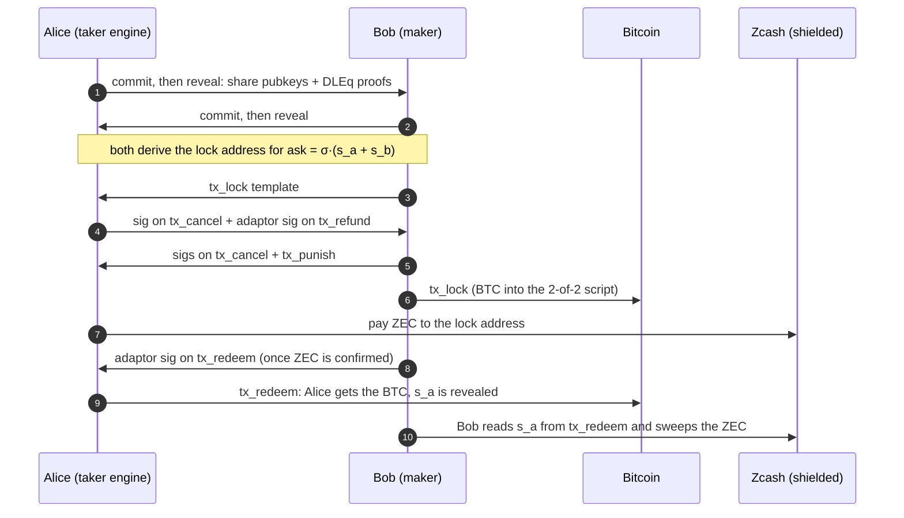
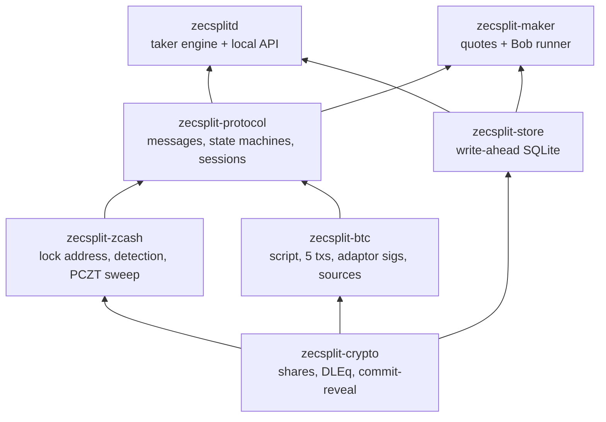

<p align="center">
  
</p>

<h1 align="center">ZecSplit</h1>

<p align="center">
  <b>Swap shielded ZEC for BTC with nobody in the middle who can freeze, steal or watch.</b>
</p>

<p align="center">
  <a href="https://github.com/trudransh/Splitzec/actions/workflows/ci.yml"></a>
  
  
  
  <a href="https://zecsplit.gitbook.io/zecsplit-docs/"></a>
</p>

> [!WARNING]
> **Pre-alpha. Regtest and testnet only. Unaudited.** Do not use with real funds.

## What it is

ZecSplit is a trustless atomic swap between **shielded ZEC** (Zcash Ironwood pool) and **BTC**. No bridge, no custodian, no wrapped coin and no transparent Zcash address at any point.

Shielded Zcash has no scripting language, so it can't hold a hash-locked contract. ZecSplit adapts the Bitcoin–Monero protocol of Gugger (2020) instead:

- The ZEC is locked to a fresh shielded address whose spending key is `ask = σ·(s_a + s_b)`, the sum of two secret shares. Alice holds `s_a`, Bob holds `s_b`, and neither can spend alone.
- Every condition (redeem, cancel after `t1`, refund, punish after `t2`) lives in **Bitcoin script**.
- Each Bitcoin spending path reveals **exactly one share** to the other party through an ECDSA adaptor signature. Whoever learns the missing share can sweep the ZEC.
- A cross-group discrete-log equality proof ties each share on Pallas (Zcash) to its twin on secp256k1 (Bitcoin), so neither side can cheat with mismatched keys.

On Zcash, a swap is two ordinary shielded transactions. Nothing on the Zcash chain links them to the Bitcoin side.

## How a swap works

Alice has ZEC and wants BTC (the taker). Bob has BTC and wants ZEC (the maker).



If something goes wrong, the timelocks decide:

| Situation | What happens | Who gets what |
|---|---|---|
| Bob never locks BTC | Alice never pays ZEC. Nothing to undo. | Both keep their coins |
| Alice never pays ZEC | After `t1`, `tx_cancel`, then Bob's `tx_refund` | Bob gets his BTC back |
| Bob goes silent after Alice pays | After `t1`, Alice cancels. Bob's `tx_refund` reveals `s_b` | Bob gets BTC back, Alice sweeps her ZEC back |
| Bob never refunds | After `t2`, Alice's `tx_punish` | Alice takes the BTC; the ZEC stays locked |

## What a swap proves, and what it doesn't

| A completed swap proves | It does not prove |
|---|---|
| Neither party could take both coins | That the price was fair: the signed quote only proves the maker offered it |
| The ZEC never touched a transparent address | That the BTC side is private (Bitcoin is public) |
| Bitcoin facts were agreed by at least two independent sources | Anything about the code: it is unaudited |

## Status

Built for the Zecathon (Cross-Chain track).

| Piece | State |
|---|---|
| Cross-group DLEq, commit-reveal, proofs of knowledge | Done, unit tested (rogue-key and mismatched-twin attacks rejected) |
| Shared-key Ironwood lock and sweep | Done, swept on a Zebra regtest chain |
| Bitcoin script, 5 transactions, adaptor signatures | Done |
| Alice and Bob state machines, write-ahead store, recovery file | Done; every state resumes after a crash |
| Full swap on regtest (real BTC lock and redeem, real ZEC lock and sweep) | Done |
| Engine and maker runners | Done in-process; real network ports in progress |
| Engine HTTP API, maker service, web UI | In progress |
| Testnet swap | Planned |

## Architecture



- **The browser holds no keys.** The local engine runs the swap and owns every secret. The web UI only shows engine state.
- **Write-ahead.** Every state change is committed to SQLite before the message or broadcast it allows.
- **Two Bitcoin sources.** The taker trusts a Bitcoin fact only when two independent sources agree.

## Quickstart (devnet)

Needs Rust 1.93, Docker and [`just`](https://github.com/casey/just).

```bash
just setup          # enable the git hooks
just check          # fmt, clippy, tests, cargo deny, secret scan
just devnet-up      # Zebra regtest + bitcoind + a funded shielded wallet
just devnet-test    # lock and sweep on Zcash, Bitcoin sources, full swap on regtest
```

## Docs

Full documentation: **[zecsplit.gitbook.io/zecsplit-docs](https://zecsplit.gitbook.io/zecsplit-docs/)**

| Start here | |
|---|---|
| [Core concepts](https://zecsplit.gitbook.io/zecsplit-docs/core-concepts) | The idea in ten minutes |
| [Protocol](https://zecsplit.gitbook.io/zecsplit-docs/protocol) | The spec, rule by rule |
| [Threat model](https://zecsplit.gitbook.io/zecsplit-docs/security/threat-model) | 25 threats, their mitigations and tests |
| [Privacy](https://zecsplit.gitbook.io/zecsplit-docs/security/privacy) | What each observer learns |
| [Paper](https://zecsplit.gitbook.io/zecsplit-docs/resources/paper) | The protocol in paper form |

## License

Dual-licensed under [MIT](LICENSE-MIT) or [Apache-2.0](LICENSE-APACHE), at your option.
