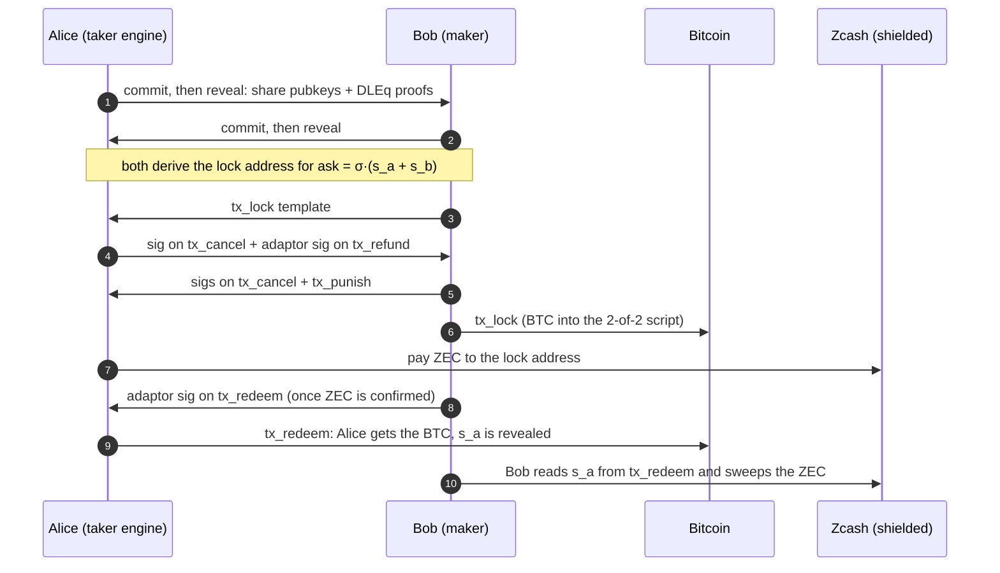
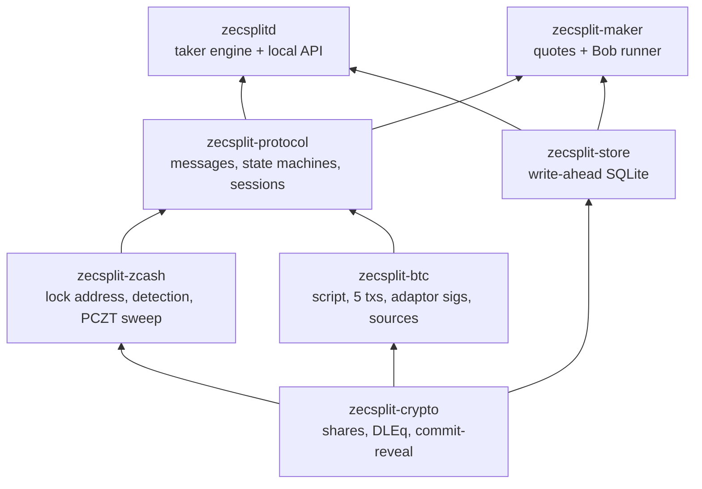

<p align="center">
  
</p>

<h1 align="center">ZecSplit</h1>

<p align="center">
  <b>Swap shielded ZEC for BTC with nobody in the middle who can freeze, steal or watch.</b>
</p>

<p align="center">
  <a href="https://github.com/trudransh/Splitzec/actions/workflows/ci.yml"></a>
  
  
  
  <a href="https://zecsplit.gitbook.io/zecsplit-docs/"></a>
</p>

> [!WARNING]
> **Pre-alpha. Regtest and testnet only. Unaudited.** Do not use with real funds.

## What it is

ZecSplit is a trustless atomic swap between **shielded ZEC** (Zcash Ironwood pool) and **BTC**. No bridge, no custodian, no wrapped coin and no transparent Zcash address at any point.

Shielded Zcash has no scripting language, so it can't hold a hash-locked contract. ZecSplit adapts the Bitcoin–Monero protocol of Gugger (2020) instead:

- The ZEC is locked to a fresh shielded address whose spending key is `ask = σ·(s_a + s_b)`, the sum of two secret shares. Alice holds `s_a`, Bob holds `s_b`, and neither can spend alone.
- Every condition (redeem, cancel after `t1`, refund, punish after `t2`) lives in **Bitcoin script**.
- Each Bitcoin spending path reveals **exactly one share** to the other party through an ECDSA adaptor signature. Whoever learns the missing share can sweep the ZEC.
- A cross-group discrete-log equality proof ties each share on Pallas (Zcash) to its twin on secp256k1 (Bitcoin), so neither side can cheat with mismatched keys.

On Zcash, a swap is two ordinary shielded transactions. Nothing on the Zcash chain links them to the Bitcoin side.

## How a swap works

Alice has ZEC and wants BTC (the taker). Bob has BTC and wants ZEC (the maker).



If something goes wrong, the timelocks decide:

| Situation | What happens | Who gets what |
|---|---|---|
| Bob never locks BTC | Alice never pays ZEC. Nothing to undo. | Both keep their coins |
| Alice never pays ZEC | After `t1`, `tx_cancel`, then Bob's `tx_refund` | Bob gets his BTC back |
| Bob goes silent after Alice pays | After `t1`, Alice cancels. Bob's `tx_refund` reveals `s_b` | Bob gets BTC back, Alice sweeps her ZEC back |
| Bob never refunds | After `t2`, Alice's `tx_punish` | Alice takes the BTC; the ZEC stays locked |

## What a swap proves, and what it doesn't

| A completed swap proves | It does not prove |
|---|---|
| Neither party could take both coins | That the price was fair: the signed quote only proves the maker offered it |
| The ZEC never touched a transparent address | That the BTC side is private (Bitcoin is public) |
| Bitcoin facts were agreed by at least two independent sources | Anything about the code: it is unaudited |

## Status

Built for the Zecathon (Cross-Chain track).

| Piece | State |
|---|---|
| Cross-group DLEq, commit-reveal, proofs of knowledge | Done; rogue-key and mismatched-twin attacks rejected |
| Shared-key Ironwood lock and sweep | Done, on regtest and on Zcash testnet |
| Bitcoin script, 5 transactions, adaptor signatures | Done; redeem, cancel, refund and punish mined on regtest |
| Alice and Bob state machines, write-ahead store, recovery file | Done; both sides resume after a crash at any state |
| Engine (local HTTP API + SSE) and maker service | Done; separate processes over HTTP |
| Every scenario on regtest through the real engine and maker | Done: happy path, maker never locks, taker never pays, maker blind to ZEC, maker never refunds, overpayment, crash every tick |
| **Live swap on Zcash testnet + Bitcoin signet** | **Done** (txids below) |
| Web UI (landing + swap) | Done |

## Live on testnet

Shielded testnet ZEC swapped for signet BTC, the maker on a cloud VM checking the lock on its own Zebra node, the taker's engine on a laptop with two Bitcoin sources.

| Swap | Maker locks BTC (signet) | Taker pays ZEC (testnet) | Taker claims BTC (signet) | Maker sweeps ZEC (testnet) |
|---|---|---|---|---|
| 1 | [`dbc65938…`](https://mempool.space/signet/tx/dbc6593847db04dec256aca4dae00c8b5df6a478731d981291be2c7b7937cda1) | [`62cfea06…`](https://testnet.zcashexplorer.app/transactions/62cfea0652d9ec5675db266bcc28f6bac7e63b0ba0f2443b5a1cf03e1e88805c) | [`8968f8f0…`](https://mempool.space/signet/tx/8968f8f08afe3f0bce599b47115f28f42bd0d67ea04f1a92df9137fa525be35d) | [`22451c4e…`](https://testnet.zcashexplorer.app/transactions/22451c4e6e6c8e720ddfec7cc45756b76ed3e9cc95628773c08c3685e94a25e7) |
| 2 | [`224e049f…`](https://mempool.space/signet/tx/224e049f3ba6f7945304e0ed684f8009ccfb1159bf557bb4c7d51873e17af774) | [`2139bd7a…`](https://testnet.zcashexplorer.app/transactions/2139bd7a3a0cb4b24438bca3cf3464d6e83d5eea384fbcd1901114e5f0a8824d) | [`f1569274…`](https://mempool.space/signet/tx/f15692748402e1730c8d36fee1ff3d212057027ac40668381a249f640d2205bd) | [`9125fcb0…`](https://testnet.zcashexplorer.app/transactions/9125fcb06fa15dce4301c17bbbe3b451de0a1769c710d8b1cbaec1f8bfe6a8fc) |
| 3 | [`27024c5d…`](https://mempool.space/signet/tx/27024c5da837cb9ed1dc4eeda2c2f128d4692418e9dea07000f0bdee7af48f9a) | [`abdb747f…`](https://testnet.zcashexplorer.app/transactions/abdb747f0f471fd6a9844940c2db95ef43e68c5362a8a99912ed19f57e189aa6) | [`dce3fce1…`](https://mempool.space/signet/tx/dce3fce1aa550cab3b3e7e2b190b1a2b4388f51104471d375252fcfaf29b3d35) | [`85af11f5…`](https://testnet.zcashexplorer.app/transactions/85af11f506ee0fbf558b2f9d612f7bef1d05d68d027186bb8c02208d528a2c30) |

Run your own with [`ops/testnet/swap.sh`](ops/testnet/swap.sh) against a maker you host ([`ops/testnet`](ops/testnet)).

## How it has been attacked

- **Model check.** Both state machines are driven through 20,000 random runs each, with reorgs, disagreeing Bitcoin sources, block jumps and hostile peer messages. After every step it checks the rules that keep funds safe: no payment request before a confirmed lock, no redeem inside the safety margin, no cancel against your own redeem, no sweep without the other side's secret, no abort after paying or locking. It found a real bug (a reorg could abort a taker who had already paid), now fixed.
- **Fuzzing.** Mutated setup signatures, adaptor signatures, lock templates and reveals are all rejected, before and after the real one, and never leave a session unusable. The wire and recovery-file decoders take 60,000 random inputs without a panic.
- **Adversarial tests** for a fake BTC lock, a maker checking ZEC on someone else's node, wrong ZEC amounts, a signature arriving inside the safety margin, a blocked refund (the taker punishes) and quote flooding.
- **Privacy tests on real chains.** Every Zcash transaction has zero transparent and zero Sapling parts and exactly 2 Ironwood actions; no secret appears in any file the engine or maker writes; nothing asks a light server for a transaction by id.

## Architecture



- **The browser holds no keys.** The local engine runs the swap and owns every secret. The web UI only shows engine state.
- **Write-ahead.** Every state change is committed to SQLite before the message or broadcast it allows.
- **Two Bitcoin sources.** The taker trusts a Bitcoin fact only when two independent sources agree.

## Judge kit

Needs Rust 1.93, Docker and [`just`](https://github.com/casey/just).

```bash
just devnet-up      # Zebra regtest (NU7) + bitcoind + a funded shielded wallet
just demo           # 3 swaps between real engine and maker processes, privacy checks, then a refund; prints every txid
```

About 4 minutes once built (the first build of the Zcash crates takes longer).

## Development

```bash
just setup          # enable the git hooks
just check          # fmt, clippy, tests, cargo deny, secret scan (what CI runs)
just devnet-test    # every scenario on regtest through the real engine and maker
```

## Docs

Full documentation: **[zecsplit.gitbook.io/zecsplit-docs](https://zecsplit.gitbook.io/zecsplit-docs/)**

| Start here | |
|---|---|
| [Core concepts](https://zecsplit.gitbook.io/zecsplit-docs/core-concepts) | The idea in ten minutes |
| [Protocol](https://zecsplit.gitbook.io/zecsplit-docs/protocol) | The spec, rule by rule |
| [Threat model](https://zecsplit.gitbook.io/zecsplit-docs/security/threat-model) | 25 threats, their mitigations and tests |
| [Privacy](https://zecsplit.gitbook.io/zecsplit-docs/security/privacy) | What each observer learns |
| [Paper](https://zecsplit.gitbook.io/zecsplit-docs/resources/paper) | The protocol in paper form |

## License

Dual-licensed under [MIT](LICENSE-MIT) or [Apache-2.0](LICENSE-APACHE), at your option.
