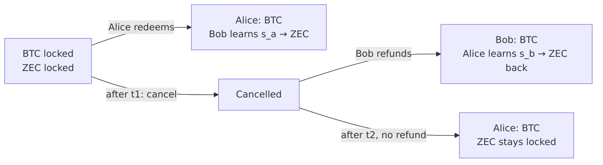

# Core concepts

The four ideas that make a shielded atomic swap possible.

## Roles

|           | Has | Wants | In v1                                                                  |
| --------- | --- | ----- | ---------------------------------------------------------------------- |
| **Alice** | ZEC | BTC   | The **taker**: runs the local engine and accepts a quote               |
| **Bob**   | BTC | ZEC   | The **maker**: a service that quotes and completes swaps automatically |

## 1. A spending key split in two

An Ironwood (Orchard-style) note is spent with a RedPallas signature under the spend-authorizing key `ask`. The zero-knowledge proof needs only viewing data, never `ask` itself. So `ask` can be **shared additively**:

```
ask = σ · (s_a + s_b)
```

Alice generates `s_a`, Bob generates `s_b`. Together they form one shielded address that **neither can spend alone**. `σ` is `+1` or `−1`, chosen so the combined public key satisfies Orchard's sign rule (`ỹ(ak) = 0`).

The viewing keys (`nk`, `rivk`) are derived from a transcript of the setup, so neither party chooses them.

## 2. One secret, two curves

Zcash keys live on the Pallas curve; Bitcoin keys on secp256k1. Each share is a number valid on **both** curves, with a public key on each:

```
S_a^P = [s_a]·SpendAuthG   (Pallas, Zcash)
S_a^S = [s_a]·G            (secp256k1, Bitcoin)
```

A **cross-group discrete-log equality (DLEq) proof** shows both public keys hide the same secret. Without it, a cheater could publish two unrelated keys, and revealing the Bitcoin one would not unlock the Zcash side.

## 3. Adaptor signatures

An ECDSA **adaptor signature** is a signature encrypted under a point `Y = [y]·G`:

* Whoever knows `y` can decrypt it into a valid signature.
* Anyone who sees **both** the encrypted and the decrypted signature can compute `y`.

ZecSplit uses each party's secp256k1 share point as its adaptor point. So when a party publishes a decrypted signature on Bitcoin, it hands its share to the other party.

## 4. All the logic on Bitcoin

The BTC sits in a 2-of-2 output. Five pre-built transactions decide every ending:

| Transaction | When                                                 | Reveals                                 |
| ----------- | ---------------------------------------------------- | --------------------------------------- |
| `tx_redeem` | Happy path: Alice claims the BTC                     | `s_a` to Bob, who sweeps the ZEC        |
| `tx_cancel` | After `t1` blocks, either party                      | nothing                                 |
| `tx_refund` | After cancel: Bob takes his BTC back                 | `s_b` to Alice, who sweeps her ZEC back |
| `tx_punish` | After cancel plus `t2` blocks, if Bob never refunded | nothing; Alice takes the BTC            |

Relative timelocks (BIP68) are baked into the signed transactions, so nobody can cancel before `t1` or punish before `t2`.

## Putting it together



In every ending, each party holds either its own asset or the other party's. That is atomicity.
