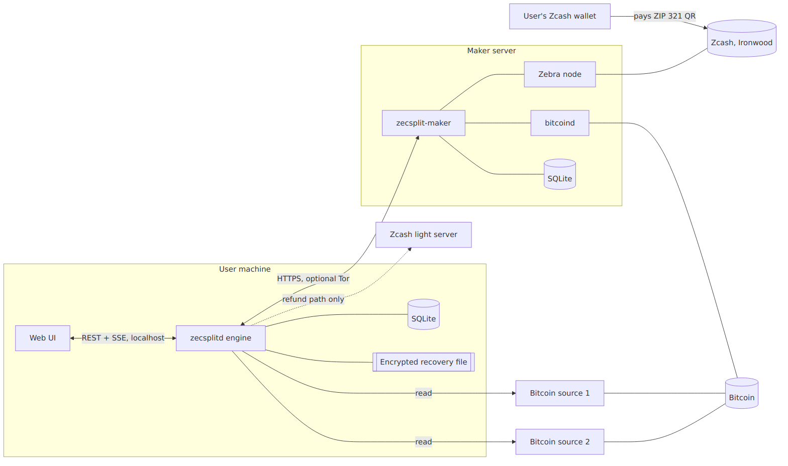
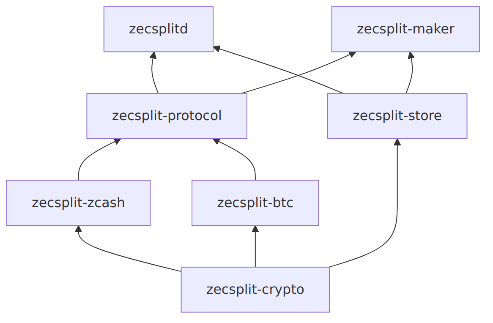

# Developers

How ZecSplit is built.

## The decision that shapes everything

**The browser is the screen. A local engine runs the swap.**

A swap can last hours (up to `t1 + t2` blocks). It must survive closed tabs and sleep, it holds secrets, and it has deadlines. A browser alone can't do this safely: background tabs are throttled, storage gets evicted, and Zcash proving in WASM is slow. So:

* `zecsplitd`, a Rust engine, runs on the user's machine; the web UI ([zecsplit.vercel.app](https://zecsplit.vercel.app)) talks to it over localhost only.
* The web UI only shows engine state. It holds no keys, never builds a payment request itself, and refuses to talk to an engine that isn't on the same computer.
* The same UI can later be wrapped as a desktop or mobile app against the same engine API.

## Components

## Crates

Lower crates never depend on higher ones.

| Crate               | Responsibility                                                                                                               |
| ------------------- | ---------------------------------------------------------------------------------------------------------------------------- |
| `zecsplit-crypto`   | Share generation with the cross-group DLEq, commit-reveal, proofs of knowledge, the σ rule, transcript hashing, secret types |
| `zecsplit-zcash`    | Lock viewing key and address, lock detection, sweep via PCZT with external RedPallas signatures                              |
| `zecsplit-btc`      | Script `W`, the five transaction templates, BIP143 signing, ECDSA adaptor signatures, Bitcoin data sources                   |
| `zecsplit-protocol` | Wire messages, the Alice and Bob state machines, swap sessions, the recovery file                                            |
| `zecsplit-store`    | Write-ahead SQLite store: swaps, events, transactions, sealed sessions                                                       |
| `zecsplitd`         | Taker engine: Alice's swap runner, local API, resume on start                                                                |
| `zecsplit-maker`    | Maker service: Bob's swap runner, signed quotes, limits                                                                      |

## Invariants across crates

* **The browser holds no keys.** The engine owns every secret.
* **Write-ahead.** Every state transition is committed to SQLite before the broadcast or message it permits, and broadcasts are idempotent.
* **Exhaustive state machines.** No wildcard match arms; every state defines what happens if a deadline passed while offline.
* **Two Bitcoin sources** for the taker; the maker checks Zcash only on its own node.
* **No transparent ZEC anywhere**, and `swap_id` is in every hash domain and every signed message.
* **Secrets** (`s_a`, `s_b`, `ask`, Bitcoin keys) are zeroizing types with no `Debug`, `Display` or `Serialize`. They never reach logs, the UI, the network or plaintext database columns.
* **Deadlines are block heights.** Wall-clock time appears only in the UI.
