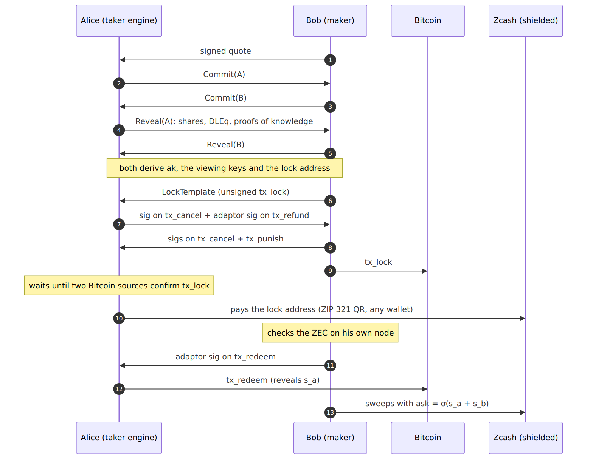

# Protocol

The ZecSplit protocol, from quote to sweep.

This section is the public version of the ZecSplit protocol specification. Every rule has an ID like `§4.4-R1`, and the tests that check a rule carry its ID in their name, for example `spec_4_4_r1_refuses_redeem_inside_margin`.

Normative words: **MUST**, **MUST NOT**, **SHOULD**, **MAY**.

## A swap at a glance

## Pages

| Page                                                                                  | Spec sections |
| ------------------------------------------------------------------------------------- | ------------- |
| [Notation and quote](protocol/notation-and-quote.md)                   | §1, §2        |
| [Key setup](protocol/key-setup.md)                                     | §3.1–§3.3     |
| [Bitcoin transactions](protocol/bitcoin-transactions.md)               | §3.4, §3.5    |
| [Happy path](protocol/happy-path.md)                                   | §4            |
| [Failure paths and timelocks](protocol/failure-paths-and-timelocks.md) | §5            |
| [State machines and recovery](protocol/state-machines-and-recovery.md) | §6            |
| [Wire messages](protocol/wire-messages.md)                             | §7            |
| [Network constants](protocol/network-constants.md)                     | §8            |

## Lineage

ZecSplit adapts the Bitcoin–Monero cross-chain atomic swap by J. Gugger (2020), implemented by COMIT as `xmr-btc-swap` and now maintained as eigenwallet. In Gugger's version Monero is the chain without scripts. Here, Zcash Ironwood takes that role.
