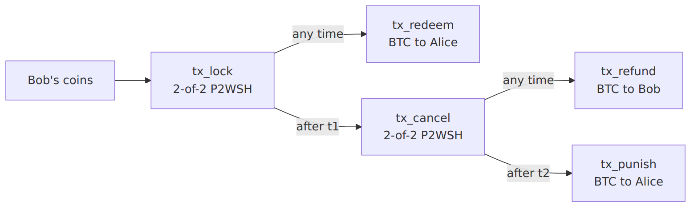

# Bitcoin transactions

Script W, the five transactions, and the signature exchange (spec §3.4, §3.5).

All transactions are P2WSH, version 2, `SIGHASH_ALL`, with BIP143 signature hashes.

```
W = OP_2 <K_1> <K_2> OP_2 OP_CHECKMULTISIG
```

`K_1` and `K_2` are `K_a` and `K_b` in lexicographic order. Both lock outputs pay to `P2WSH(W)`.

## The five transactions

| Tx          | Input (nSequence)                        | Output                                                                   |
| ----------- | ---------------------------------------- | ------------------------------------------------------------------------ |
| `tx_lock`   | Bob's UTXOs, **SegWit only**             | `V_lock = btc_amount + fee(tx_redeem)` to `P2WSH(W)`, plus change to Bob |
| `tx_redeem` | lock outpoint (`0xFFFFFFFD`)             | `btc_amount` to Alice                                                    |
| `tx_cancel` | lock outpoint (**`t1`**, BIP68 blocks)   | `V_lock − fee(cancel)` to `P2WSH(W)`                                     |
| `tx_refund` | cancel outpoint (`0xFFFFFFFD`)           | the rest to Bob's refund address                                         |
| `tx_punish` | cancel outpoint (**`t2`**, BIP68 blocks) | the rest to Alice                                                        |



**§3.4-R1.** Fees are `ceil(btc_fee_rate × vsize)`, with vsize estimated for the 2-of-2 witness and fixed at setup. Every transaction is fully determined by the quote, the keys, the addresses and `tx_lock`'s outpoint.

**§3.4-R2.** `tx_lock` MUST spend only SegWit inputs, so its txid can't change (malleability) before broadcast. Otherwise the pre-signed transactions would become invalid and the BTC would be held hostage.

**§3.4-R3.** Relative timelocks are enforced by BIP68 through the **signed** nSequence. Both signatures commit to it, so nobody can broadcast `tx_cancel` before `t1` or `tx_punish` before `t2`.

## Signature exchange (§3.5)

**§3.5-R1.** Bob sends `tx_lock` unsigned, as a PSBT. Both parties build the other four transactions from it.

**§3.5-R2.** Alice → Bob:

* `sig_A(tx_cancel)`, an ECDSA signature;
* `esig_A(tx_refund; Y_b)`, an **ECDSA adaptor signature** encrypted under Bob's adaptor point. When Bob publishes the refund, Alice can recover `s_b`.

**§3.5-R3.** Bob → Alice: `sig_B(tx_cancel)` and `sig_B(tx_punish)`.

**§3.5-R4.** Each party MUST verify every signature it receives, plain or adaptor, and abort on failure.

**§3.5-R5.** Bob MUST NOT broadcast `tx_lock` until he holds valid `sig_A(tx_cancel)` and `esig_A(tx_refund)`. Otherwise his BTC could be held hostage.

## Who can sign what

| Tx          | Alice's signature                   | Bob's signature                     | Revealed when published |
| ----------- | ----------------------------------- | ----------------------------------- | ----------------------- |
| `tx_redeem` | her own                             | from `esig_B`, decrypted with `s_a` | `s_a` to Bob            |
| `tx_cancel` | exchanged at setup                  | exchanged at setup                  | nothing                 |
| `tx_refund` | from `esig_A`, decrypted with `s_b` | his own                             | `s_b` to Alice          |
| `tx_punish` | her own                             | exchanged at setup                  | nothing                 |
