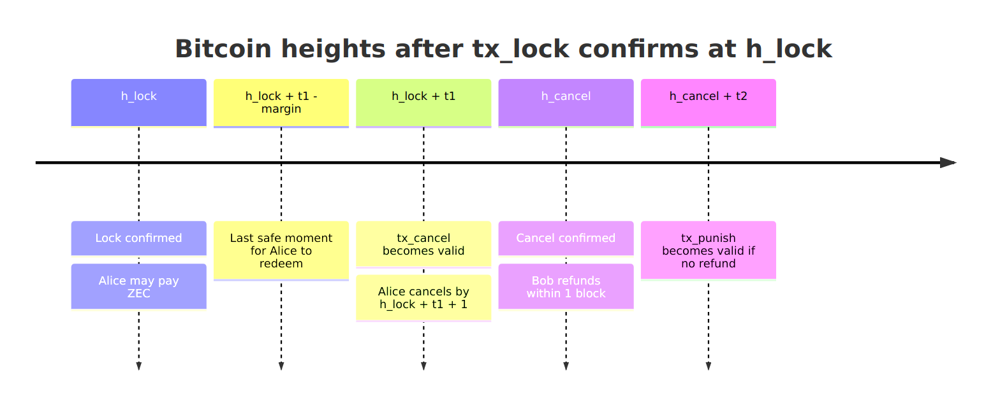

# Failure paths and timelocks

What happens when someone abandons the swap or goes silent (spec §5).

## 5.1 Before `tx_lock` confirms

Either party MAY abort. Nothing is at risk. Alice MUST NOT pay ZEC before two sources confirm the lock.

## 5.2 BTC locked, ZEC never paid (Alice abandons)

After `t1`, Bob broadcasts `tx_cancel`, then `tx_refund`. The refund reveals `s_b`, which costs Bob nothing because there is no ZEC to sweep.

## 5.3 Both locked, Bob never sends `esig_B`

This also covers Alice deciding not to redeem.

* **R1.** After `t1`, **either party** broadcasts `tx_cancel`. Alice's engine MUST do so by `h_lock + t1 + 1`.
* **R2.** Bob SHOULD broadcast `tx_refund` at once. That reveals `s_b`.
* **R3.** Alice recovers `s_b` from her own `esig_A` and the published refund signature, then sweeps her ZEC back with `ask = σ·(s_a + s_b)`.
* **R4.** If no refund has confirmed by `h_cancel + t2`, Alice MUST broadcast `tx_punish`. She gets the BTC and the ZEC stays locked forever.
* **R5.** Bob's engine MUST broadcast the refund within 1 block of the cancel confirming, and CPFP it if needed. Otherwise he risks losing both the BTC and the ZEC.

## 5.4 Alice's margin is violated

Alice MUST NOT reveal `s_a`. She proceeds as in §5.3. A redeem that doesn't confirm before cancel would reveal `s_a` while Bob can still refund, and Bob would get both assets.

## 5.5 Wrong ZEC amount

Bob doesn't send `esig_B`. The swap proceeds as in §5.3, and Alice sweeps back whatever she sent. Overpayments come back the same way: Bob MUST NOT keep partial or over-payments on the happy path.

## Summary

| Situation                   | Path                 | Result                                       |
| --------------------------- | -------------------- | -------------------------------------------- |
| Bob never locks BTC         | §5.1 abort           | Both keep their coins                        |
| Alice never pays ZEC        | §5.2 cancel → refund | Bob gets his BTC back                        |
| Bob silent after Alice pays | §5.3 cancel → refund | Bob gets BTC back, Alice sweeps her ZEC back |
| Bob never refunds           | §5.3-R4 punish       | Alice gets the BTC, the ZEC stays locked     |
| Wrong ZEC amount            | §5.5 → §5.3          | Alice gets her ZEC back                      |
