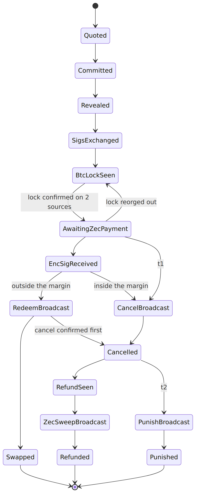
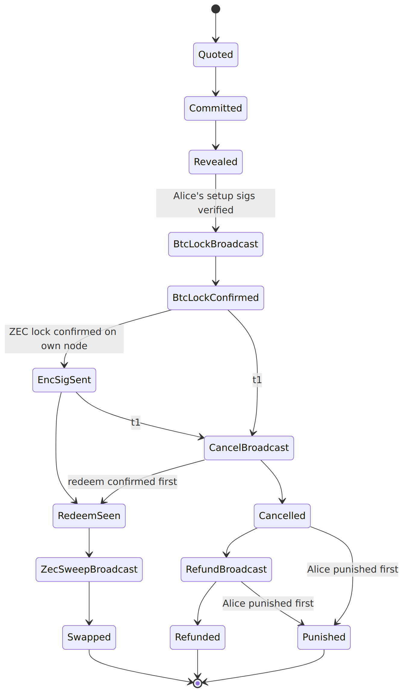

# State machines and recovery

Alice's and Bob's states, write-ahead persistence, resume and the recovery file (spec §6).

Both state machines are pure functions: `(state, input) → (next state, actions)`. Inputs are messages from the peer and snapshots of both chains. The runner persists the new state, then performs the actions.

## Alice (taker)

From any state before `AwaitingZecPayment`, Alice moves to `Aborted` if the maker misbehaves or never locks. Nothing is at risk there: she hasn't paid. Once the payment request has been shown, she never aborts: a reorg of the BTC lock only hides the request until the lock confirms again.

## Bob (maker)

From `Quoted`, `Committed` or `Revealed`, Bob moves to `Aborted` if the taker misbehaves or setup times out. He hasn't locked anything yet.

## Persistence

**§6.3-R1 (write-ahead).** Every transition MUST be committed to the database **before** the side effect it permits (a broadcast or a message). Broadcasts MUST be idempotent: re-broadcasting a known transaction is a no-op.

**§6.3-R2 (resume).** On start, the engine loads every non-terminal swap, re-reads chain state and runs the transition table from there. Every state has a defined action for "a timeout passed while offline".

In the implementation, a session is saved as its keys plus a log of every input it received, sealed with the user's passphrase. Restoring replays that log through the same checks. Signing is deterministic (RFC 6979 and deterministic adaptor nonces), so a restored session produces byte-identical messages and transactions. A repeated setup message is answered again; a conflicting one is refused.

## Recovery file (§6.4)

**§6.4-R1.** Alice's recovery file contains:

* `swap_id`, her role and the quote;
* `s_a`, `k_a` and the transcript `T`;
* every transaction template, plus Bob's `sig_B(tx_cancel)`, `sig_B(tx_punish)` and, if received, `esig_B(tx_redeem)`;
* **her own `esig_A(tx_refund)`**, without which she can't recover `s_b` from Bob's refund;
* the maker endpoint.

Bob's database likewise keeps his own `esig_B(tx_redeem)`, which he needs to recover `s_a`.

The file is encrypted with a passphrase (`age` with scrypt). A fresh install plus the file plus the passphrase MUST be able to finish any happy or failure path.
